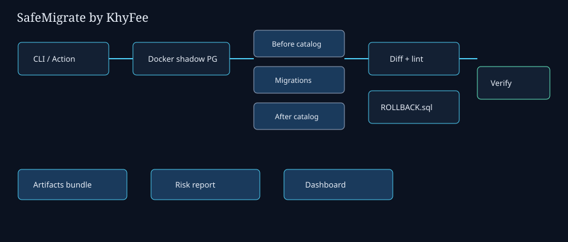

# SafeMigrate

**Zero-Downtime Migration Sandbox** by [KhyFee](https://github.com/KhyFee).

Spin up a Dockerized Postgres shadow clone, run migrations, emit a structural schema diff, and **auto-generate rollback SQL** — then verify the rollback restores the prior schema. No AI.

Developed privately before this public release — commit history reflects open packaging, not a simulated multi-month timeline.

## Quick start

```bash
npm install
# Docker required for demo
npm run demo
# inspect .safemigrate/ROLLBACK.sql, diff.md, report.md
```

## What it catches

- Dropped columns/tables, risky type changes, NOT NULL without default
- Expand/contract statement lint + structural catalog diff
- Policy fail-on for CI (`fail-on: destructive`)

**Honest limit:** schema structure (+ tiny seed checks). Lock duration under production data volume is not simulated.

## CLI

```bash
npx @khyfee/safemigrate doctor
npx @khyfee/safemigrate demo [--strict] [--step]
npx @khyfee/safemigrate migrate --dir ./migrations --baseline ./schema.sql
```

## Architecture



## License

MIT (c) KhyFee
